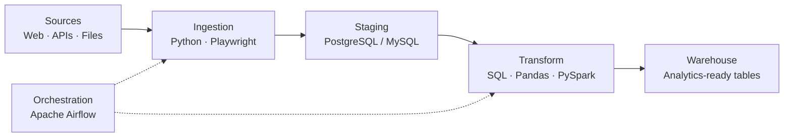

<!--
  GitHub Profile README
  Repository: Lonelywolfarko/Lonelywolfarko  (must match your username to show on your profile)
-->

<div align="center">


<a href="https://github.com/Lonelywolfarko">
  
</a>

<br/>

<a href="https://www.linkedin.com/in/developerarkomondal/"></a>
<a href="https://mail.google.com/mail/?view=cm&fs=1&to=arko03472@gmail.com&su=Opportunity%20for%20Arko%20Mondal"></a>
<a href="https://x.com/MondalArko39"></a>

</div>

<br/>

## 👋 About Me

I'm an **Electronics & Communication Engineering undergraduate (graduating 2027)** with **8+ months of software development experience at a startup**. I'm moving toward **Data Engineering**, combining a solid Python and automation background with growing depth in SQL, databases, and ETL/ELT design.

I like practical problems: taking a slow, repetitive, manual workflow and turning it into something reliable and automated.

| | |
|---|---|
| 🎯 **Primary focus** | Data Engineering |
| 💪 **Core strengths** | Python development · Browser automation · Web scraping |
| 🔎 **Also interested in** | Technical data analysis · Data platforms |
| 🎓 **Education** | B.E. in Electronics & Communication Engineering (2027) |
| 🌱 **Currently learning** | Airflow · PySpark · Data warehousing · Cloud data platforms |

<br/>

## 🧰 Tech Stack

<div align="center">

| Area | Tools |
|:--|:--|
| **Languages & Data** |     |
| **Databases** |   |
| **Automation** |   |
| **Backend & APIs** |    |
| **Tools** |   |
| **Learning now** |     |

</div>

<br/>

## 🚀 Featured Work

### 📄 Government Tender PDF Collection Automation
`Python` · `Playwright` · `Browser Automation`

An automation workflow that collects government tender PDF documents from **multiple dynamic sources**, replacing repetitive manual collection.

- **Problem:** Tender documents were spread across dynamic websites and gathered by hand.
- **Solution:** Browser-based automation that retrieves documents reliably from each source.
- **Impact:** Significantly reduced manual collection effort in a real business workflow.

> *Built during startup work, so implementation details may be restricted.*

### 🌐 Software & Web Development (Startup)
Worked on software and web projects in a startup environment, delivering against practical client and business requirements and applying programming and automation to real workflows.

<br/>

## 🔄 How I Think About Data Pipelines

The architecture I'm building toward as I move into Data Engineering:



<br/>

## 🎯 Current Focus

- [x] Python development and browser automation in a production-style workflow
- [ ] Writing efficient SQL and strengthening database fundamentals
- [ ] Building Python-based data cleaning and transformation workflows
- [ ] Designing maintainable ETL/ELT pipelines with Airflow
- [ ] Learning data warehousing and cloud data platforms
- [ ] Strengthening software engineering practices through hands-on projects

<br/>

## 📊 GitHub Stats

<div align="center">


</div>

<br/>

## 🎮 Fun Zone

### 🐍 Snake Eating My Contributions
<div align="center">
  <picture>
    <source media="(prefers-color-scheme: dark)" srcset="https://raw.githubusercontent.com/Lonelywolfarko/Lonelywolfarko/output/github-snake-dark.svg" />
    <source media="(prefers-color-scheme: light)" srcset="https://raw.githubusercontent.com/Lonelywolfarko/Lonelywolfarko/output/github-snake.svg" />
    
  </picture>
</div>

### 🧠 Guess the Output: Python & SQL Edition
Think you know the answer? Make your guess, then click to reveal.

<details>
<summary><b>Round 1:</b> The classic float trap</summary>

```python
print(0.1 + 0.2 == 0.3)
```
<details>
<summary>👉 Reveal answer</summary>

**`False`**. Floating-point numbers can't represent 0.1 or 0.2 exactly, so the sum is `0.30000000000000004`. Use `math.isclose()` for comparisons.
</details>
</details>

<details>
<summary><b>Round 2:</b> The set that surprises people</summary>

```python
print(len(set([1, True, 1.0, "1"])))
```
<details>
<summary>👉 Reveal answer</summary>

**`2`**. `1`, `True` and `1.0` are equal and hash the same, so they collapse into one item. The string `"1"` stays separate.
</details>
</details>

<details>
<summary><b>Round 3:</b> The sneaky default argument</summary>

```python
def add(x, acc=[]):
    acc.append(x)
    return acc

print(add(1), add(2))
```
<details>
<summary>👉 Reveal answer</summary>

**`[1, 2] [1, 2]`**. The default list is created once and shared across calls. Use `acc=None` and create a new list inside the function.
</details>
</details>

<details>
<summary><b>Round 4:</b> The SQL NULL trap (a data engineer's favorite)</summary>

A table `t` has a column `val` containing the values `1`, `NULL`, `3`.

```sql
SELECT COUNT(*) AS a, COUNT(val) AS b FROM t;
```
<details>
<summary>👉 Reveal answer</summary>

**`a = 3`, `b = 2`**. `COUNT(*)` counts rows, while `COUNT(val)` skips NULLs. This is a common source of silent bugs in data pipelines.
</details>
</details>

### 🕹️ Take a Break
Play in your browser: [2048](https://play2048.co/) · [Tetris](https://tetris.com/play-tetris) · [Wordle](https://www.nytimes.com/games/wordle/index.html) · [Chess](https://www.chess.com/play/computer)

<br/>

## 🤝 Let's Connect

I'm looking to connect with engineers, data professionals, and teams working on **data platforms, automation, and software engineering**. If you're hiring for a Data Engineering internship or entry-level role, I'd love to talk.

<div align="center">

<a href="https://www.linkedin.com/in/developerarkomondal/"></a>
<a href="mailto:arko03472@gmail.com"></a>
<a href="https://x.com/MondalArko39"></a>


</div>
